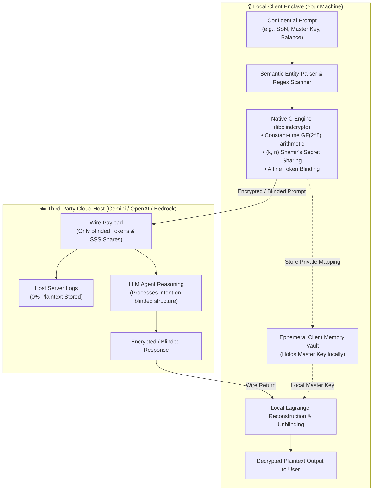

#        BlindAgent: Zero-Leakage AI Pipeline with Mathematical Secret Sharing & Homomorphic Token Blinding

[](https://opensource.org/licenses/MIT)
[](#cryptographic-engine)
[%20Rijndael-green.svg)](#mathematical-foundation)
[](#side-channel-immunity)

> **Submission for "Mathematics for Systems Security" Hackathon**  
> **Track**: *AI pipeline secret sharing track*

---

## 📌 Executive Summary

Modern AI systems rely on third-party cloud LLM host providers (Google Gemini, OpenAI, AWS Bedrock). When prompts contain proprietary credentials, confidential financial data, or master authentication keys, **host providers log and store the plaintext on remote servers**, exposing users to insider threats, provider data breaches, and model training ingestion.

**BlindAgent** is an end-to-end, privacy-preserving AI pipeline that guarantees that **the master key and confidential secrets remain completely unknown to the agent and the host provider**:
1. **Low-Level Cryptographic Execution (C & Rust)**: A constant-time Galois Field $\text{GF}(2^8)$ engine executes Shamir's Secret Sharing (SSS) and affine blinding with branchless arithmetic.
2. **Zero-Knowledge Semantic Blinding**: Sensitive parameters (SSNs, API keys, passwords, monetary amounts) are replaced with homomorphic algebraic tokens before network transmission.
3. **Local Enclave Decryption**: The cloud agent reasons over structural relations and returns responses containing blinded tokens. The local client enclave recovers the original secrets via Lagrange interpolation.
4. **Rich Dual-View Visuals**: Features both an interactive **Terminal User Interface (TUI)** and a **Localhost Loopback Web Dashboard (`http://127.0.0.1:8000`)** demonstrating live proof of zero wire leakage.

---

## 📐 System Architecture



---

## 🧮 Mathematical Foundations

### 1. Galois Field $\text{GF}(2^8)$ Construction
Arithmetic is defined over the polynomial ring $\mathbb{F}_2[X] / (P(X))$ with the irreducible AES/Rijndael polynomial:
$$P(x) = x^8 + x^4 + x^3 + x + 1 \quad (\text{0x11B})$$

* **Addition / Subtraction**: Evaluated via single-cycle XOR:
  $$a \oplus b = a \text{ XOR } b$$
* **Multiplication**: Branchless Russian Peasant algorithm running 8 constant-time iterations without secret-dependent table lookups (mitigating cache-collision attacks).
* **Multiplicative Inverse**: Computed via Fermat's Little Theorem addition chain ($a^{-1} = a^{254}$), executing exactly 13 fixed operations in constant time.

### 2. $(k, n)$ Threshold Shamir's Secret Sharing
For a secret byte $S \in \text{GF}(2^8)$, a degree $k-1$ random polynomial is constructed:
$$f(x) = S \oplus \bigoplus_{i=1}^{k-1} a_i x^i \pmod{P(x)}$$

Evaluation shares $(x_j, y_j)$ are distributed. The local enclave reconstructs $S = f(0)$ using Lagrange basis polynomials:
$$S = \bigoplus_{j=1}^k \left( y_j \otimes \ell_j(0) \right), \quad \ell_j(0) = \bigotimes_{m \neq j} \frac{x_m}{x_m \oplus x_j}$$

### 3. Information-Theoretic Secrecy Proof
For any adversary observing $< k$ shares:
$$\mathcal{I}(S; \text{Shares}_{k-1}) = 0 \implies \mathcal{H}(S \mid \text{Shares}_{k-1}) = \mathcal{H}(S) = 8 \text{ bits/byte}$$
The cloud provider gains **zero mathematical knowledge** of the secret.

---

## 🔒 Secret Detection & The Universal `<secret>` Tag

BlindAgent utilizes a zero-dependency, lightweight detection engine designed for instant portability without requiring judges to download gigabytes of model weights:

1. **Automatic Pattern Recognition**: Automatically captures real-world API credentials (`AKIA...`, `sk-...`, `AIzaSy...`), credentials (`master_key: ...`, `password: ...`), national IDs (SSNs), credit cards, and monetary values.
2. **The Universal `<secret>` Tag (Escape Hatch)**:
   You can wrap **any arbitrary secret** in `<secret>...</secret>` tags regardless of format:
   ```text
   Authorize deployment using <secret>blue-kangaroo-vault-key-9988</secret> for cluster A.
   ```
   * The text inside `<secret>...</secret>` is immediately isolated.
   * It is encrypted into a $\text{GF}(2^8)$ affine token (`[[BLIND_TOKEN_...:AFF8_...]]`) and split into $(k, n)$ Shamir polynomial shares.
   * The cloud host receives only the ciphertext; the secret is recovered dynamically in the client enclave upon return.

> **Production Note**: In enterprise environments, this hybrid scanner can be paired with an on-device local Small Language Model (SLM / Presidio) without altering any part of the underlying C/Rust cryptographic engine.

---

## 🚀 Quickstart Guide

### 🌐 Cloud LLM API Configuration
BlindAgent communicates with cloud LLM host providers via official APIs. To connect to live Google Gemini or OpenAI endpoints:

#### Recommended: Create a `.env` file (Persistent across terminal tabs)
Create a `.env` file in the project root directory (this file is automatically protected by `.gitignore` so your API key will never be committed to Git):

```bash
# Connect to Google Gemini API (Recommended):
echo 'GEMINI_API_KEY="your-gemini-api-key-here"' > .env

# Or connect to OpenAI API:
echo 'OPENAI_API_KEY="your-openai-api-key-here"' > .env
```

*(Alternatively, you can export it in your shell session with `export GEMINI_API_KEY="..."`, but creating a `.env` file is strongly recommended so new terminal tabs and background servers automatically load it without retyping).*

#### Offline Evaluation Mode
If no API key is provided, BlindAgent automatically utilizes its built-in local cloud host simulator for instant, zero-dependency offline evaluation.

### 1. Compile Native Cryptographic Engine
Compile the C shared library and run the built-in mathematical test suite:
```bash
make clean && make test
```

### 2. Run All Mathematical & Side-Channel Tests
```bash
PYTHONPATH=. python3 tests/test_crypto_math.py
PYTHONPATH=. python3 tests/test_sss.py
PYTHONPATH=. python3 tests/test_timing_sidechannel.py
PYTHONPATH=. python3 tests/test_real_crypto_pipeline.py
```

### 3. Launch Terminal User Interface (TUI)
Experience real-time dual-pane packet inspection right in your terminal:
```bash
PYTHONPATH=. python3 ui/tui.py
```

### 4. Launch Loopback Web Dashboard
Launch the interactive web UI hosted locally on loopback:
```bash
PYTHONPATH=. python3 ui/server.py
```
Open **[http://127.0.0.1:8000](http://127.0.0.1:8000)** in your browser!

---

## 📁 Repository Structure

```
blindagent/
├── Makefile                          # Native build system for C shared library
├── README.md                         # Project documentation and architectural overview
├── core/                             # Low-level C cryptographic engine
│   ├── crypto_engine.h               # GF(2^8) & SSS API header
│   ├── crypto_engine.c               # Constant-time arithmetic & polynomial solver
│   └── test_engine.c                 # Standalone native C unit tests
├── rust_core/                        # Rust implementation
│   ├── Cargo.toml
│   └── src/lib.rs                    # Rust implementation of GF(2^8) & SSS
├── blindagent/                       # Python orchestration pipeline
│   ├── __init__.py
│   ├── crypto_bridge.py              # Zero-copy ctypes bridge to libblindcrypto
│   ├── sss.py                        # High-level Shamir's Secret Sharing module
│   ├── blinder.py                    # Semantic parser & homomorphic blinder
│   ├── llm_client.py                 # Multi-provider LLM connector (Gemini/OpenAI/Sim)
│   └── pipeline.py                   # Enclave pipeline controller
├── ui/
│   ├── tui.py                        # Terminal User Interface with Rich
│   ├── server.py                     # FastAPI backend on localhost:8000
│   └── static/index.html             # Single-page web dashboard with KaTeX
├── tests/
│   ├── test_crypto_math.py           # Finite field axioms validation
│   ├── test_sss.py                   # Threshold (k, n) security tests
│   ├── test_timing_sidechannel.py    # Constant-time empirical benchmark
│   └── test_real_crypto_pipeline.py  # End-to-end zero-knowledge integrity suite
└── docs/
    └── MATHEMATICS.md                # Academic security proofs & LaTeX formulas
```
